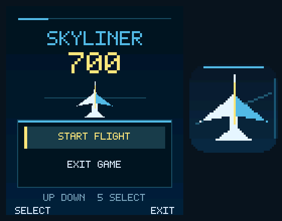
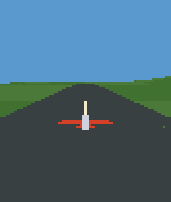

# Skyliner700 — Nokia 6600 / Symbian

Нативная 3D-демка для **Nokia 6600**, Symbian 7.0s / S60 2nd Edition.
Версия **0.1.21 — прямой вывод в framebuffer**. На настоящем телефоне автор сообщил о **~30 FPS в полёте**
после оптимизации 0.1.8; частота зависит от сцены.

[Скачать установщик 0.1.21](dist/Skyliner700-0.1.21.sis)





## Что внутри

- Полноценная программная 3D-растеризация с Z-буфером и отсечением полигонов.
- Целочисленная математика Q16.16: телефонная сборка не требует FPU.
- Таблицы sin/cos на 360 углов, таблицы sqrt и atan.
- Оптимизации для ARMv4T: развёрнутые пиксельные циклы, кэширование проекций,
  LUT для 1/Z без деления при проекции вершины, специализированные ARM-пути.
- RGB565, сцена 88×104 с масштабированием до экрана 176×208.
- Вывод через Direct Screen Access, модель самолёта, процедурный рельеф и полоса.
- Главное меню, пауза, выход в систему и системная иконка.

## Установка и управление

Передайте `.sis` на телефон по Bluetooth и установите. На телефоне не нужны SDK
или дополнительные библиотеки. Поддержка проверялась на Nokia 6600;
совместимость с другими моделями не проверялась.

| Кнопка | Действие |
|---|---|
| Джойстик вверх / вниз | Опустить / поднять нос |
| Джойстик влево / вправо | Крен и поворот в соответствующую сторону |
| Удерживать 3 / 1 | Увеличить / уменьшить газ |
| Удерживать 7 / 9 | Рыскание влево / вправо |
| 5 / центр джойстика / левая софт-клавиша | Меню / подтверждение |
| 0 | Вернуться на полосу |
| # / правая софт-клавиша | Выход в систему |

В меню: вверх/вниз или 2/8 — выбор. При потере фокуса включается пауза.
HUD показывает скорость, высоту над землёй, тягу и FPS.
В 0.1.10 исправлены знаки боковой подъёмной силы и изменения курса при крене,
а также направление рыскания 7/9.

## 0.1.21: framebuffer без промежуточной bitmap полёта

Путь вывода: `88×104 RGB565 → SkyScale2x → экранная память`.
Полноэкранная bitmap полёта и её BitBlt удалены: на 73 216 байт меньше
пиксельных данных в памяти, без дополнительного чтения/копирования этой
bitmap каждый кадр. Прежний ARM-путь масштабирования с 32-битной записью
пар пикселей работает непосредственно с адресом экрана и его шагом строк.

Адрес берётся из HAL `EDisplayMemoryAddress`, к нему прибавляется
`EDisplayOffsetToFirstPixel`. Смещение первого пикселя и шаг строки запрашиваются
для текущего `EDisplayMode`. Проверяются 16 бит, RGB, EColor64K, портретный
порядок, нормальная ориентация, 176×208, выравнивание и границы адресов.
Нет жёстко заданного адреса, шага 352 байта или предполагаемого заголовка палитры.

DSA остаётся владельцем разрешения на запись. Прямоугольники DrawingRegion
имеют экранные координаты и переводятся в координаты окна. Полностью видимое
окно получает быстрый SkyScale2x; частичная видимость — масштабирование только
разрешённых пикселей, включая нечётные границы. В AbortNow указатель и шаг
сразу сбрасываются без вызовов WS. После Restart параметры получаются заново.

HUD сохраняет DrawText/DrawRect через DSA GC. Полноэкранных BitBlt нет вообще,
включая меню: подготовленное меню копируется по разрешённым строкам напрямую.
Меню по-прежнему хранит отдельную bitmap для подготовки картинки; Z-буфер
и исходный буфер сцены 88×104 остаются прежними. Межкадровый таймер не возвращён.

Если прошивка не возвращает необходимые параметры HAL или формат не подходит,
сборка отказывается писать по неподтверждённому адресу; запасного BitBlt-пути нет.
Диагностика записывается на телефоне в `C:\Skyliner700-display.log` при получении
параметров либо ошибке HAL. Сборка 0.1.20 сохранена для сравнения и отката.

1200 host-проверок полного/частичного вывода и меню проверяют пиксели,
раздельные области, нечётные границы, разные шаги/выравнивание и защитные поля.
Нативный аудит проверяет HAL::Get и отсутствие импортов BitBlt. На телефоне
новый путь и выигрыш FPS ещё не проверены: сравнивайте с 0.1.20 в той же сцене,
проверьте меню, уход в систему и возврат. Предыдущий результат 27–30 FPS
относится к 0.1.20.

Описание [области DSA](https://docs.huihoo.com/symbian/s60-3rd-edition-cpp-developers-library-v1.1/GUID-35228542-8C95-4849-A73F-2B4F082F0C44/html/SDL_93/doc_source/reference/reference-cpp/WSERV8.1/CDirectScreenAccessClass.html)
и [параметров HAL](https://github.com/SymbianSource/oss.FCL.sf.os.kernelhwsrv/blob/master/halservices/hal/inc/hal_data.h).
Набор API проверен также по локальным заголовкам S60 SDK 2.0; поздние комментарии
HAL не заменяют проверку значений, возвращаемых реальной прошивкой EKA1.

## 0.1.20: benchmark без межкадрового ожидания

В полёте удалён RTimer: после завершения кадра нет дополнительной задержки
10 мс и нет целевого ограничения в 30 FPS. Цикл проверяет готовые завершения
через `RThread::RequestCount()` и забирает их неблокирующим в этих условиях
`WaitForAnyRequest()`. Затем обрабатывает до 32 событий WS, готовые DSA/redraw AO
и сразу рисует следующий кадр. Ограничение пакета событий не даёт потоку
кнопок бесконечно откладывать отрисовку.

В меню, при потере фокуса и остановленном DSA ожидание событий остаётся:
там непрерывный рендер не нужен. Флаг незавершённого пакета вспомогательных AO
не позволяет уснуть, если достигнут лимит их обработки. Все пути меню/выхода
и восстановление параметров автоповтора обслуживаются при пробуждениях.

Счётчик FPS совпадает с 0.1.17–0.1.19. Проверять на телефоне следует одинаковую
сцену: стоянка, прямой полёт, затем крен; для отдельного замера ввода — удержание
3 при уже установленных 100% газа. Сравнивайте с 0.1.19. Полученный результат
покажет скорость полного кадра, включая ввод, физику, рендер и DSA. Сборка не
гарантирует 32–38 FPS; скорость ещё не измерена. Плавный режим с целевым временем
кадра пока не добавлен: эта версия реализует вариант теста без таймера.

## 0.1.19: собственный цикл запросов и кадров

Вместо ведущего CPeriodic используется собственный цикл ожидания, как в
исследованном пути Tony Hawk N-Gage. При старте стандартный запрос CONE
синхронно отменяется через `CCoeEnv::Cancel()`. Затем игра сама владеет
`RWsSession::EventReady`, `GetEvent` и соответствующим `TRequestStatus`.
Второго потребителя этой очереди нет.

Цикл ждёт `User::WaitForAnyRequest()`, забирает готовое событие и немедленно
перевыставляет EventReady. Down/Up обновляют таблицу сканкодов и маски кнопок;
переведённые EEventKey не участвуют в игровом управлении. В этом пути нет
вызова HandleWsEventL/OfferKeyEventL и обхода контролов. Физика читает снимок
кнопок с прежним фиксированным шагом 20 мс. Кадр запускается непосредственно
из цикла при завершении собственного RTimer (прежняя задержка 10 мс).

Готовые вспомогательные запросы обслуживаются через
`CActiveScheduler::RunIfReady(error, -25)`, как в исследованном движке.
Так продолжают работать DSA и redraw AO. Не-клавиатурные стандартные события
передаются S60 для обработки фокуса, сообщений приложений и изменений экрана.
На выходе сначала отменяются и завершаются собственные WS/таймерные запросы,
цикл возвращается, затем отдельный callback завершает приложение. Ошибка
с выходом через Leave записывается в `C:\Skyliner700-loop.log` на телефоне.

Сопоставление с исследованным образом: 0x463D8C — постановка EventReady,
0x4641D8 — GetEvent и повторная постановка, 0x4641AC — Down/Up по сканкоду,
0x44FA08/0x44FA94 — состояние и снимок кнопок; 0x463DEC/0x464068 — ожидание
запросов и обслуживание RunIfReady с порогом -25. Переходники 0x4C27B8,
0x4C27D8 и 0x4C27F8 подтверждены как WaitForAnyRequest, RunIfReady и
RequestCount по импортам SDK. Это новая реализация для Skyliner700;
коммерческий код и файлы игры не включены.

Нативная сборка и проверки пройдены; запуск нового цикла, переключение
приложений, DSA restart и FPS требуют проверки на Nokia 6600. Для сравнения
с 0.1.17/0.1.18 удерживайте 3 при 100% газа в одинаковой сцене, затем проверьте
5, выход правой софт-клавишей/#, сочетание крена с газом, уход в систему
и возврат с паузы. Сборка 0.1.18 сохранена для отката.

## 0.1.18: прямой обработчик событий и снимок кнопок

Игровые `EEventKeyDown/Up` обрабатываются в `CFlightUi::HandleWsEventL`
до обхода контролов Avkon. `OfferKeyEventL` больше не участвует в игровом вводе.
Обработчик только обновляет состояние по сканкоду; физика, рисование, меню
и выход выполняются в кадре. Есть удержание, нажатие и отпускание; короткое
нажатие между кадрами сохраняется, повторное Down не создаёт новую команду.
256 байтов хранят состояния физических сканкодов; счётчики учитывают несколько
кнопок одного действия (5, центр джойстика, левая софт-клавиша).
При потере фокуса и DSA abort все состояния и ожидающие команды очищаются.

Архитектура следует найденной схеме ввода Tony Hawk для N-Gage, но интегрирована
в существующий S60-каркас: CONE остаётся единственным владельцем
`EventReady/GetEvent`, а приложение перехватывает игровые события до Avkon.
Собственный цикл ожидания как в Tony Hawk целиком не перенесён. Системные
события, переключение приложений и DSA продолжают обрабатываться каркасом.
Новый код написан для Skyliner700, код и файлы коммерческой игры не включены.

Ускорение на Nokia 6600 пока не измерено. Для сравнения с 0.1.17 проверьте
удержание 3 при уже установленных 100% газа в одинаковой сцене, затем меню,
короткое нажатие 5, сочетание крена с газом и возврат из системного меню.

## 0.1.17: автоповтор и точный счётчик FPS

Во время активного полёта автоповтор откладывается на большой интервал.
Исходные общесистемные параметры сохраняются и восстанавливаются при паузе,
потере фокуса, завершении и после DSA abort. В самом `AbortNow` нет WS-вызовов.
Оставшиеся повторные `EEventKey` отбрасываются до команд меню/сброса.
Удержание по-прежнему читает битовую маску `KeyDown/KeyUp`; физика работает
только в фиксированном тике. Включён `ENoKeyBlock` для сочетаний клавиш.

Счётчик FPS теперь считает интервалы кадров за секунду, без занижающего
целочисленного EMA. Поэтому рост показаний относительно прежних версий
сам по себе не доказывает ускорение. Для проверки ввода сравните нейтральное
управление с удержанием 3 при уже установленных 100% газа в той же сцене.
Гипотеза о WSERV и дребезг джойстика на телефоне пока не подтверждены.

## 0.1.16: парный ARM-кернел растеризации

Два значения Z читаются заранее, затем независимые вычисления заполняют
интервал до сравнения. Если оба пикселя проходят тест и буферы выровнены,
цвет и глубина записываются 32-битными словами. Смешанные результаты
обрабатываются точными 16-битными записями. Нечётные границы и несовместимое
выравнивание сохраняют прежний путь. Парный кернел включается от 8 пикселей,
чтобы распределить накладные расходы вызова на несколько пар.
Внутри ARM-цикла нет обращений к стеку или вызовов функций. Регистры
сохраняются один раз на входе/выходе. 10000 случаев реального ARM-кода
проверены в Unicorn; 10000 portable span-проверок и 80 кадров совпадают
с эталоном. Эмуляция не измеряет кэш, stalls или такты ARM920T.
Прирост относительно 0.1.15 на телефоне ещё не измерен.

## 0.1.15: рельеф и привязка сетки без делителей

Сокращение Q16.16-масштабов устранило 64-битные деления на константы 90
и 100. Оставшиеся 32-битные операции с константами GCC заменяет умножениями
и сдвигами; ARM-аудит подтверждает отсутствие делителей в `TERRAIN.o` и
в прямом коде `Render`. В плоской зоне аэродрома расчёт холмов пропускается.
Процедурная высота, шаг сетки 100 единиц, округление и вид сцены сохранены.
Миллион высот и координат привязки совпал с предыдущей реализацией.
Деление в отсечении полигонов пока остаётся. FPS 0.1.15 ещё не измерен.

## 0.1.14: аэродинамика и тригонометрия без делителей

Четыре прямых деления в аэродинамике заменены точными умножениями на
reciprocal. Для констант 20 и 50 множители готовы заранее; для переменной
горизонтальной/полной скорости применяется общая LUT и коррекция округления.
`FxTan` читает таблицу 360 значений (1440 байт); `FxAtan2` получает октантное
отношение через нормализованный reciprocal без деления. Углы и округление
сохранены. ARM-аудит: в `PHYSICS.o` и `FIXED.o` нет division/modulo helpers.
Миллион проверок отношений, тангенс, траектория и 80 кадров проходят.
В вызываемых физикой запросах рельефа деления ещё остаются.
FPS версии 0.1.14 на телефоне ещё не измерен.

## 0.1.13: общий reciprocal площади

Три деления для Z-градиентов и начальной глубины заменены одним общим
Q63 reciprocal площади, вычисленным через существующую LUT и целочисленные
уточнения. Знаковые результаты совпадают с прежним делением, включая
округление к нулю. ARM-аудит подтверждает отсутствие division/modulo helper
вызовов во всей `RasterScreen`: настройке треугольника и цикле строк.
Отсечение и физика всё ещё используют программное деление.
Все 80 кадров совпадают с эталоном. FPS версии 0.1.13 ещё не измерен.

## 0.1.12: границы строк без деления

Обратные шаги рёбер вычисляются один раз на треугольник через общую LUT.
В цикле строк границы span вычисляются умножением и точной коррекцией
floor/ceil. Новая таблица не нужна. Миллион случайных случаев, граничные
значения и 80 кадров совпадают с эталоном. В ARM-объекте рендерера больше
нет зависимости от `__divsi3`; деления для Z-градиентов и отсечения остаются.
FPS версии 0.1.12 на телефоне ещё не измерен.

## 0.1.11: проекция без деления

Вместо `(1LL << 40) / z` используется таблица из 256 значений (1 КБ),
нормализация глубины и два целочисленных уточнения Ньютона. Получается
точный прежний Q40 reciprocal: экранные координаты и глубина совпадают
с делением. Контрольные суммы всех 80 кадров также совпадают.
ARM-аудит проверяет отсутствие division/modulo helper-вызовов в `Project`.
Деления в отсечении, настройке растеризации и физике пока остаются.
FPS версии 0.1.11 на телефоне ещё не измерен.

## Сборка для телефона

Нужны Windows, **S60 2nd Edition SDK 2.0** с GCC и Windows Perl.
Пути проекта и SDK должны быть без пробелов и на одном диске.
SDK и инструменты в репозиторий не включены.
Источники инструментов и исправления для современных Windows:
[BUILD_NOTES.md](BUILD_NOTES.md).

Из каталога `symbian` в PowerShell:

```powershell
$env:PATH = 'C:\Perl\bin;' + $env:PATH
.\build-s60.ps1 -SdkRoot C:\S60SDK
```

Результат — `Skyliner700.sis` (ARMI UREL). В `dist/` лежит проверенный установщик.
SHA256 установщика 0.1.21:
`920828dfba42e4e7e8efb3bf19218aec62ffb4fff0a367a016adb2fa4e78f02a`.

## Desktop-превью и проверки

Нужны MinGW-w64 G++, PowerShell; для аудита — Python 3.

```powershell
.\build-preview.ps1 -Compiler C:\msys64\ucrt64\bin\g++.exe
python tests/verify_sis.py dist/Skyliner700-0.1.21.sis
```

Скрипт собирает `Skyliner700-preview.exe` и запускает проверки математики,
физики, направлений поворота, меню, буферов кадра и соответствия растеризаторов.
Проекция сравнивается с эталоном на миллионе случайных точек.
`tests/audit_arm.py` проверяет нативные объекты на отсутствие FP-helper-функций
и глобальных конструкторов; аргументы — корень SDK и каталог объектов ARMI UREL.
Сводка последней проверки: [VALIDATION.txt](VALIDATION.txt).

## Структура и лицензия

`src/` — приложение и целочисленный движок; `aif/` — исходники иконки;
`group/` — описание сборки S60; `tests/` — проверки и эталоны;
`upstream/` — исходная модель PC-версии для сравнения.
Превью выше созданы desktop-рендерером, это не фотографии экрана телефона.

Порт [Skyliner700](https://github.com/Stizzzly/Skyliner700) — Stizzzly.
Лицензия [MIT](LICENSE).
